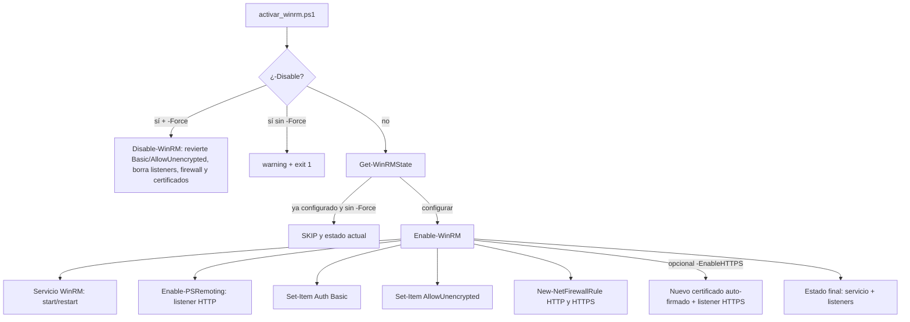

# winrm-fastconfig

Script de PowerShell para habilitar o deshabilitar WinRM en máquinas Windows de forma rápida, preparándolas para Ansible u otras herramientas de administración remota.

[](LICENSE)
[](https://github.com/bi0punk/winrm-fastconfig/actions/workflows/ci.yml)

## Contenido

- [Características](#características)
- [Arquitectura](#arquitectura)
- [Stack](#stack)
- [Estructura del repositorio](#estructura-del-repositorio)
- [Instalación](#instalación)
- [Uso](#uso)
- [Configuración](#configuración)
- [Tests / CI](#tests--ci)
- [Roadmap](#roadmap)
- [Licencia](#licencia)

## Características

- Activación de WinRM con un solo comando
- Puerto HTTP configurable (default 5985)
- Soporte para HTTPS con certificado auto-firmado (puerto 5986)
- Creación automática de reglas de firewall
- Autenticación Basic y AllowUnencrypted configurables
- Modo rollback completo (`-Disable`)
- Idempotente (skip si ya configurado, `-Force` para re-aplicar)

## Arquitectura



## Stack

- PowerShell 5.1+ (requiere `#requires -RunAsAdministrator`)
- PSScriptAnalyzer (lint en CI)

## Estructura del repositorio

```
winrm-fastconfig/
├── activar_winrm.ps1   # Script principal (enable/disable WinRM)
├── tests/              # (sin tests Pester aún)
├── .env.example        # Variables de ejemplo para conexión (no usadas por el script)
├── .github/workflows/
│   └── ci.yml          # PSScriptAnalyzer
├── .gitignore
├── LICENSE
└── README.md
```

## Instalación

```powershell
git clone https://github.com/bi0punk/winrm-fastconfig.git
cd winrm-fastconfig
```

Requisitos:
- Windows 10/11 o Windows Server 2016+
- PowerShell ejecutado como Administrador

## Uso

```powershell
# Habilitar WinRM en HTTP (puerto 5985)
.\activar_winrm.ps1

# Habilitar con HTTPS (certificado auto-firmado)
.\activar_winrm.ps1 -EnableHTTPS

# Habilitar con puerto personalizado
.\activar_winrm.ps1 -Port 5986

# Deshabilitar / rollback
.\activar_winrm.ps1 -Disable -Force
```

## Configuración

Parámetros (definidos en `activar_winrm.ps1`):

| Parámetro        | Default | Descripción                              |
|------------------|---------|------------------------------------------|
| `-Port`          | 5985    | Puerto HTTP para WinRM                   |
| `-BasicAuth`     | `$true` | Habilita autenticación Basic             |
| `-AllowUnencrypted` | `$false` | Permite tráfico sin cifrar (LAN)     |
| `-EnableHTTPS`   | off     | Crea listener HTTPS con certificado auto-firmado |
| `-HTTPSPort`     | 5986    | Puerto HTTPS                             |
| `-Disable`       | off     | Revierte toda la configuración (rollback) |
| `-Force`         | off     | Re-aplica config/confirma el rollback    |
| `-Quiet`         | off     | Output mínimo (solo errores)             |

`-Disable` requiere `-Force` para confirmar el rollback.

## Tests / CI

Github Actions (`.github/workflows/ci.yml`) instala PSScriptAnalyzer y ejecuta `Invoke-ScriptAnalyzer -Path . -Recurse -EnableExit` en `windows-latest` en cada push/PR.

## Roadmap

- [x] Enable/disable WinRM con reglas de firewall
- [x] HTTPS con certificado auto-firmado
- [ ] Soporte para configuraciones de Kerberos
- [ ] Integración con DSC (Desired State Configuration)
- [ ] Tests con Pester

## Licencia

MIT